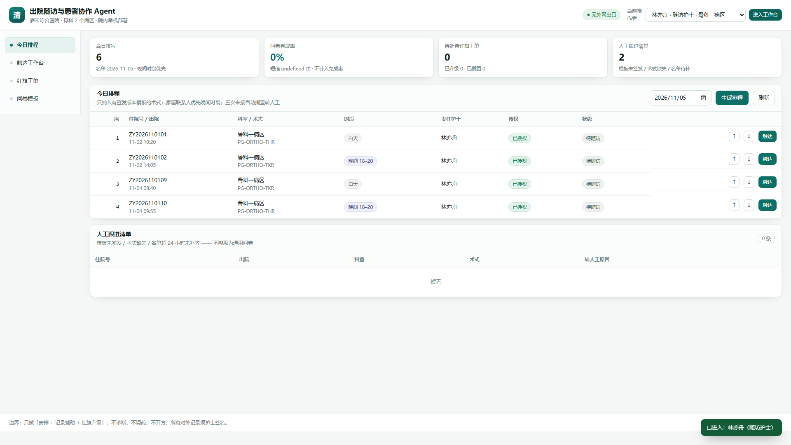
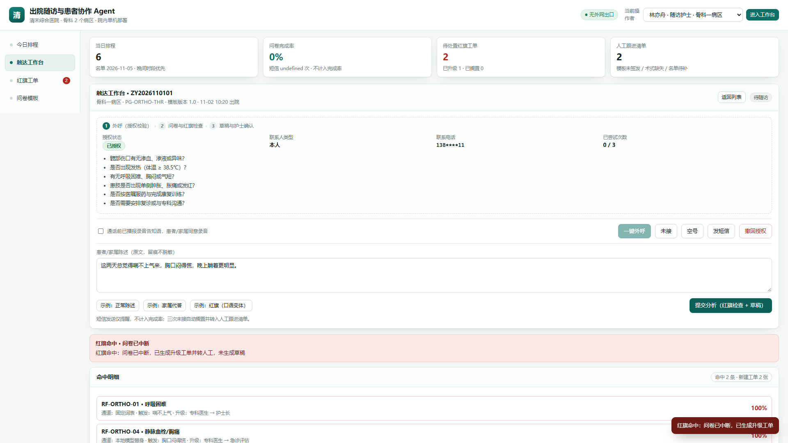
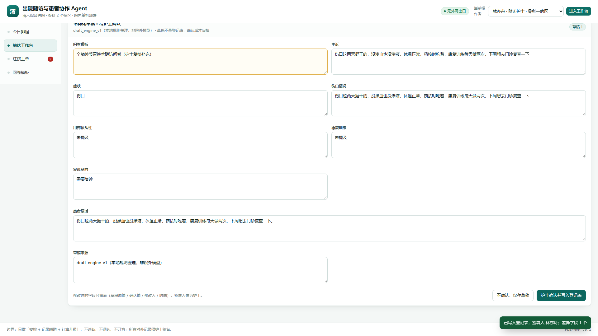

# 出院随访与患者协作 · 九阶段填写内容

> 案例来源：FDE-Simulation-Training-Center 案例库 `healthcare`（清禾综合医院 · 医疗行业 · 进阶级）
> 场景标题：门诊之后，随访之前
> 业务流程：HIS 名单导出 → 护士分组 → 外呼随访 → 危险信号升级 → 记录归档 → 专科摘要
> 试点范围：骨科 2 个病区、常规术后患者、4 周
> 范围边界：先做安排与记录辅助，不做自主诊疗、不自动挂号开方、数据院内处理不发送外部服务

## 文件索引

| 文件 | 阶段 | 交付物 |
|---|---|---|
| [00-案例事实台账.md](docs/00-案例事实台账.md) | 证据基座 | 六角色 18 条事实与证据编号（医疗-001～018） |
| [访谈记录.md](docs/访谈记录.md) | 原始资料 | 平台需求发现访谈报告（2026-11-05 导出）：六角色证据采集 33/36、逐条访谈问答、证据缺口与需求归纳 |
| [01-业务挖掘.md](docs/01-业务挖掘.md) | 阶段 1 | 业务机会清单、指标基线与价值假设、项目章程与利益相关者地图 |
| [02-现场调研.md](docs/02-现场调研.md) | 阶段 2 | 访谈记录与角色地图、现状流程图与异常路径、四来源收敛表与证据台账 |
| [03-需求定义.md](docs/03-需求定义.md) | 阶段 3 | 问题优先级、需求规格与追溯矩阵（REQ-01～06）、验收清单 |
| [04-方案设计.md](docs/04-方案设计.md) | 阶段 4 | 试点方案与方案比较、架构图与数据权限矩阵、构建与评估计划 |
| [05-构建集成.md](docs/05-构建集成.md) | 阶段 5 | 数据契约、原型闭环说明、异常处理与审计样例 |
| [06-测试评估.md](docs/06-测试评估.md) | 阶段 6 | 评估集（90 例）、测试报告、缺陷闭环与质量结论 |
| [07-客户试点.md](docs/07-客户试点.md) | 阶段 7 | 试点执行计划、用户验收记录、试点收益复核与决策纪要 |
| [08-上线交接.md](docs/08-上线交接.md) | 阶段 8 | 上线准备三方评审、发布与回滚演练记录、交接清单 |
| [09-运营迭代.md](docs/09-运营迭代.md) | 阶段 9 | 30/60/90 天运营计划、事件复盘、复盘与下一轮迭代 |
| [设计方案.md](docs/设计方案.md) | 交付文档 | 客户端设计方案：总体架构、五模块、数据契约、权限与合规、实施与验收 |
| [报价单.xlsx](docs/报价单.xlsx) | 交付文档 | 报价汇总、明细报价、付款里程碑、假设与不含项（公式驱动，可改参数重算） |
| [附录-GitHub对标调研.md](docs/附录-GitHub对标调研.md) | 附录 A | 开源对标结论、可复用组件、需求覆盖矩阵；含 2026-11-04 安全审查、分层应用方案与逐项借鉴裁定（第六～十节） |
| [借鉴清单.md](docs/借鉴清单.md) | 附录 C | 可采用模块与代码片段逐项清单（来源、许可证、必改项、片段、验收用例、勾选表） |
| [MVP测试方案.md](docs/MVP测试方案.md) | 附录 D | MVP v0.1.0 分层测试方案（数据契约/排程/触达/红旗/确认写库/越权/异常/安全 SEC-01～12/非功能） |
| [现状与AI流程图对比.html](docs/现状与AI流程图对比.html) | 附录 B | 无 AI 现状流程与 AI 增强系统流程的对比图示 |
| [现状业务流程-无AI.pdf](docs/现状业务流程-无AI.pdf) | 附录 B-1 | 现状业务流程单页 PDF（A4） |
| [AI增强系统流程.pdf](docs/AI增强系统流程.pdf) | 附录 B-2 | AI 增强后系统流程单页 PDF（A4） |

## 最小可运行 MVP（代码）

> `docs/` 是交付文档；`backend/` `frontend/` `tools/` 是与之对应、可直接运行的最小实现。
> 纯 Python 3.13 标准库 + SQLite，零第三方依赖，仅监听 `127.0.0.1`，不调用院外模型或短信网关（医疗-013）。

| 目录 | 内容 |
|---|---|
| [backend/core/](backend/core/) | 数据契约、排程、多渠道触达、红旗规则、草稿与护士确认、工单、模板签发、审计哈希链、安全基座 |
| [backend/rules/redflag.json](backend/rules/redflag.json) | 红旗规则包 v1.0（固定词表 + 本地变体替身，宁误报不漏报） |
| [backend/fixtures/](backend/fixtures/) | HIS 名单替身（v1 正常批、v2 含超额字段与重复行） |
| [frontend/](frontend/) | 无框架单页工作台：排程、触达三步、工单、模板、审计、运维 |
| [tools/run_eval.py](tools/run_eval.py) | 90 例评估集运行器（正常 30 / 边界 20 / 对抗 20 / 权限 10 / 故障 10） |
| [tools/verify_audit.py](tools/verify_audit.py) | 审计哈希链离线校验、覆盖率与日结摘要 |

### 运行

```powershell
python -m backend.server --port 8765
# 浏览器打开 http://127.0.0.1:8765 ，默认以林亦舟（随访护士）进入
```

运行数据（SQLite 库、审计库、评估报告）落在 `data/`，已加入版本忽略。启动时终端会打印“仅监听本机回环、无外部网络出口”的边界声明。

### 界面预览

| 排程工作台 | 触达 · 红旗中断 | 确认归档 |
|:---:|:---:|:---:|
|  |  |  |

> 纯标准库单页工作台，仅监听 `127.0.0.1`；完整界面见 [frontend/](frontend/)，本地运行即可交互。

### 演示路径

1. 运维页签：导入 `his_batch_v1.json`（工程师角色）→ 生成当日排程。
2. 触达工作台：外呼（先勾选录音告知）→ 输入“喘不上气来”查看红旗中断与工单；或输入正常陈述生成草稿。
3. 草稿逐字段核对后确认（step-up 凭证 + 护士签名），记录归档并计入完成率。
4. 红旗工单由专科医生处置；问卷模板页可签发新版本，未签发版本不会下发。
5. 审计页签查看事件与覆盖率并校验哈希链；或运行 `python tools/verify_audit.py`。

### 验收自检

```powershell
python tools/run_eval.py       # 期望 90/90 通过，报告写入 data/eval_report.json
python tools/verify_audit.py   # 校验 data/followup.db 的哈希链与覆盖率
```

当前实现已通过 90/90；评估为本地真实代码运行，HIS 接口为替身模拟，真实接口联调仍列为试点准入检查项。

## 填写规则（与平台关卡一致）

1. 每项任务包含四个必填字段：**状态、责任人、证据位置、结论**；标记"已完成"必须三项齐备（结论、证据位置、责任人）。
2. 关卡分四态：待确认 / 通过 / 需返工 / 待复核。通过条件 = 本阶段三项任务全部完成 + 所有前序关卡通过 + 评审角色、依据、明确决定齐备。
3. 上游证据、任务、作品、ROI 或代码变更会使已通过关卡转为**待复核**；每份阶段文件末尾的关卡记录须注明当前有效性。
4. 除案例事实台账中的数字为案例设定值外，其余测算数字（测试结果、收益、预算拆分等）均为**演练示例**，不代表实测值。

## 证据编号规则

- 访谈事实：`医疗-0XX · 记录类型`，编号与平台 `lib/scenarios.mjs` 生成规则一致，全文见 [00-案例事实台账.md](docs/00-案例事实台账.md)。
- 业务资料锚点：`资料-HIS名单导出`、`资料-随访登记表`、`资料-术式问卷模板`、`资料-患者授权登记`、`资料-录音告知书`、`资料-红旗升级流程`、`资料-触达记录`（演练补充锚点，引用需标注版本）。

## 进度看板

| 阶段 | 任务 1 | 任务 2 | 任务 3 | 关卡 |
|---|---|---|---|---|
| 1 业务挖掘 | 已完成 | 已完成 | 已完成 | 通过（待复核触发条件：基线口径变更） |
| 2 现场调研 | 已完成 | 已完成 | 已完成 | 通过（待复核触发条件：新增访谈/矛盾未决） |
| 3 需求定义 | 已完成 | 已完成 | 已完成 | 通过（待复核触发条件：范围或验收变更） |
| 4 方案设计 | 已完成 | 已完成 | 已完成 | 通过（待复核触发条件：架构或预算变更） |
| 5 构建集成 | 已完成 | 已完成 | 已完成 | 通过（待复核触发条件：代码哈希变更） |
| 6 测试评估 | 已完成 | 已完成 | 已完成 | 通过（待复核触发条件：新失败项或复测后） |
| 7 客户试点 | 已完成 | 已完成 | 已完成 | 通过（待复核触发条件：扩大范围或新反馈） |
| 8 上线交接 | 已完成 | 已完成 | 已完成 | 通过（待复核触发条件：版本或责任人变更） |
| 9 运营迭代 | 已完成 | 已完成 | 已完成 | 通过（每 30/60/90 天例行复核） |

## 附注

- 本案例（出院随访与患者协作）的平台导出报告（九阶段，含各任务评分与关卡结论，2026-11-03 导出）保留在 [docs/reports/](docs/reports/) 目录。
